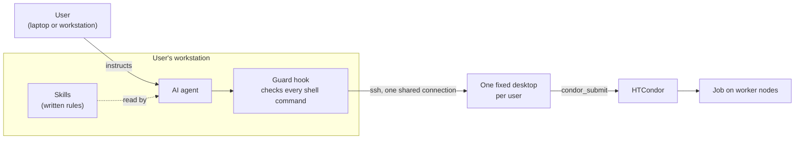
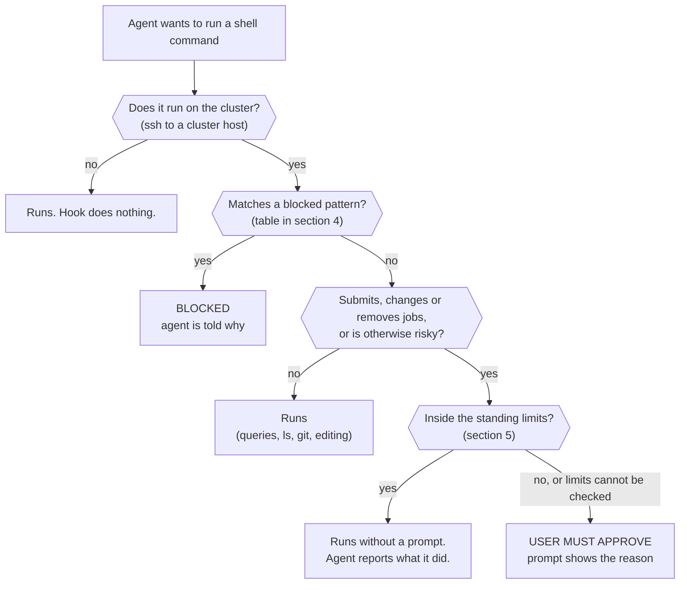
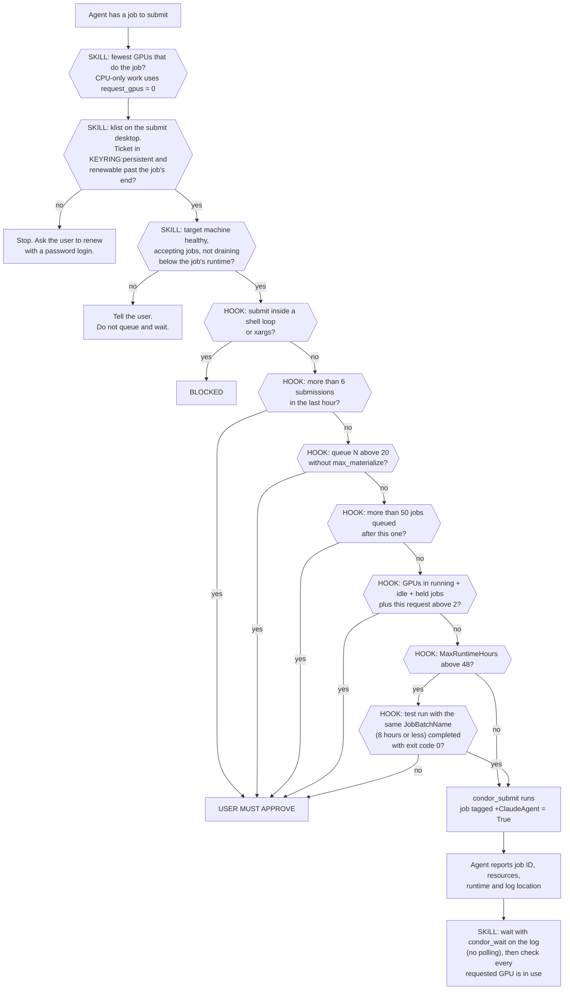

# HPC agent skills: review copy for the BAF / PHY-IT team

> **Status: under review, not for general use yet.** This version covers only
> GPU work, for one group. Please do not pass it on to other BAF users or
> install it for regular work until it also has guidelines for CPU-heavy
> jobs, and until it is clear that agents using it will not flood BAF and
> its few GPU machines, which the skill points out by name. It is public
> only so that the BAF / PHY-IT team can read it easily.

**Why you are getting this.** People have started to use AI coding agents
for their work on the clusters. An agent that does not know what it should
and should not do on a shared system can cause real problems. In AG Flek
(University of Bonn) we are building tooling around this, to minimise that
risk: written rules for the agent ("skills") and a small program that checks
its commands.

We collected agent guidelines from other HPC sites and used your
documentation and the other resources available to us to build the current
version. **Could you have a look and tell us whether any important security
consideration is clearly missing, and whether any of our settings seem
unreasonable?** Section 7 has a few concrete questions.

This repository contains only what concerns BAF. Contact: Frederik
Labonté (AG Flek).

> **Disclaimer.** This does not promise safety. It collects best practices
> from your documentation and turns them into instructions and checks for an
> agent, to help keep it from overloading the cluster. The check program is a
> seat belt, not a security boundary. Your rules always take precedence, and
> the user stays responsible for everything run under their account.

## 1. The setup at a glance

The agent runs on the user's workstation and reaches the cluster only through
`ssh`. It is never installed or started on the cluster.



Two layers do the work:

- **Skills** are written instructions the agent reads before acting. They
  shape its behaviour but cannot force it.
- **The guard hook** is a program that sees every shell command before it
  runs and can **block** it, **ask the user**, or let it pass. This is the
  part that is enforced.

## 2. What happens to every command



## 3. How a job submission goes on BAF

Steps marked **HOOK** are enforced by the program. Steps marked **SKILL** are
written rules the agent follows.



## 4. What is enforced by the program

Applies to commands sent to BAF over `ssh`. Source: [`hooks/hpc_guard.py`](hooks/hpc_guard.py);
its 270 test cases are in [`hooks/test_hpc_guard.py`](hooks/test_hpc_guard.py).

| The agent tries to | Result |
|---|---|
| Start compute on a desktop: `torchrun`, `mpirun`, `vllm`, `ollama`, `jupyter`, `tensorboard`, `deepspeed`, `accelerate launch` | **Blocked** |
| Walk a shared tree: `find`, `du`, `tree`, `ls -R`, `grep -r`, `chmod -R`, `chown -R` on `/cephfs`, `/cephfs/user`, `/home` or `/` | **Blocked** |
| Poll the scheduler: `watch condor_q`, or a loop around `condor_q`/`condor_status` sleeping less than 60 s | **Blocked** |
| Submit from a shell loop or `xargs` | **Blocked** |
| Install Anaconda/Miniconda or use the `defaults` channel | **Blocked** |
| `rm -r` on `/cephfs` itself or `/cephfs/user` | **Blocked** |
| `rm -r` anywhere else under `/cephfs` | User must approve |
| Run a Python/R/Julia script, `pytest`, or `make -j` above 8 on a desktop | User must approve |
| Submit beyond a limit (see the flow chart above) | User must approve |
| Submit a job above 48 hours without a completed short test run of the same `JobBatchName` | User must approve |
| Hold or release jobs, or `condor_qedit` a GPU request | User must approve |
| Remove jobs it did not submit, or by filter (`-all`, user name, `-constraint`) | User must approve |
| Remove its own jobs by ID (checked against the `ClaudeAgent` job attribute) | Allowed |
| Submit inside all limits | Allowed |

The same checks apply on every line of a multi-line command, in scripts
passed to a remote shell by here-document, to job files copied over with
`scp`/`rsync` in the same command, inside `bash -c` / `bash -lc` and behind wrappers such
as `nohup`, `env`, `nice` and `timeout`. The hook
fails closed: a submission passes without a prompt only when the hook has
read the whole command and every job file in it. Several submits in one
command are added up, and anything it cannot read or count asks the user, as
does a failure to query the scheduler.

**Scheduler queries the hook itself makes:** one
`condor_q -global $USER -af JobStatus RequestGPUs` per submission; one
`condor_q <id> -af ClusterId ProcId ClaudeAgent` per removal; and, only for a
job above 48 hours whose test run is on record, one `condor_history` call
with `-limit 1` that scans back no further than that test's submission.
Nothing runs periodically.

### Known gap (TODO): CPU, memory and node requests are not limited

The hook limits GPUs, the number of submissions and queued jobs, and long
runtimes. It does **not** look at `request_cpus` or `request_memory`. Checked
on 2026-11-27: a CPU-only submission of 20 jobs with 192 CPUs and 1 TB of RAM
each, for 48 hours, passed without a prompt. Sensible behaviour for CPU-heavy
work is not defined yet; until it is, only the written "request the minimum"
rule applies. This is the main reason the skill is not ready for wider use.

**Not enforced, only written rules** (the agent is told to, nothing checks):
the Kerberos ticket check, machine health check, requesting the fewest GPUs,
verifying GPU use, never setting `CUDA_VISIBLE_DEVICES`, file-count hygiene on
`$BUDDY`, choosing the lowest `CephFS_IO` class, submitting from home rather
than `/cephfs`.

## 5. Decisions currently in force

| Topic | Decision |
|---|---|
| Where the agent runs | On the user's workstation only. Commands reach BAF through `ssh` to **one fixed desktop per user**, not the `desktop.physik` load balancer, so that user's jobs, schedd and Kerberos ticket are in one place. Each user picks their own desktop at first use, or keeps the one the load balancer assigns them; the skill names no machine, so a group does not converge on one |
| Kerberos | The user logs in with their password on that desktop and keeps a `screen` session so SSSD renews the ticket. The agent logs in with an SSH key, only reads `klist`, never runs `kinit`, never sees the password |
| GPUs without asking | At most **2 in total**, counting running, idle and held jobs (held jobs count because they are released automatically every 30 minutes). A third GPU always needs the user's approval |
| Long jobs | Anything above 48 hours first runs as a reduced version (smaller problem, same GPU type, 8 hours or less, same `JobBatchName`) that must show the job starts, uses its GPUs, writes a checkpoint and resumes from it |
| GPU type | Jobs always pin `CUDADeviceName`, so nothing lands on `gpu001` by accident |
| Submissions without asking | Inside the limits: 6 per hour, 50 queued, `queue N` above 20 only with `max_materialize` |
| Removing jobs | The agent may remove its own tagged jobs by ID. Everything else asks |
| Hold/release | Never used to stage jobs around the GPU limit. A job that should not run is removed, not parked |
| Job layout | Submit files, wrapper and logs in home; data, code copy and the environment tarball on `$BUDDY`; work in `/jwd`. Nothing from CephFS in `transfer_input_files`/`transfer_output_files` |
| Python environments | Built in `/jwd` inside a batch job, stored as **one tarball** on `$BUDDY`; never unpacked on CephFS. Miniforge only |
| Multi-GPU and vLLM jobs | Run `source /etc/profile; expand_cuda_visible_devices` first; never write `CUDA_VISIBLE_DEVICES` by hand |
| Waiting for jobs | `condor_wait` on the job log. No `watch`, no polling loops |
| Quota checks | Bytes from `ls -ld $BUDDY` on the desktop; file count with `bquota` inside a job that runs anyway. Never `du` or `find` |

## 6. What is where

| File | Content |
|---|---|
| [`skills/hpc-agent-conduct/SKILL.md`](skills/hpc-agent-conduct/SKILL.md) | Rules for any shared cluster: login nodes, filesystem I/O, file counts, polling, approvals. Loaded first |
| [`skills/htcondor/SKILL.md`](skills/htcondor/SKILL.md) | HTCondor mechanics, not specific to BAF |
| [`skills/baf/SKILL.md`](skills/baf/SKILL.md) | **BAF facts and rules. This is the file we most want checked** |
| [`skills/baf/references/training-jobs.md`](skills/baf/references/training-jobs.md) | Environment tarball, submit file and wrapper for GPU training, multi-GPU and vLLM |
| [`hooks/hpc_guard.py`](hooks/hpc_guard.py) | The guard hook (also contains the Slurm checks used on Marvin) |
| [`hooks/test_hpc_guard.py`](hooks/test_hpc_guard.py) | Its tests |

**Sources.** Agent guidelines published by other HPC sites; your Confluence pages (BAF, HTCondor on BAF, HTCondor GPU jobs,
Helpful HTCondor commands, JDL tips, CephFS, Conda and VirtualEnvs,
Prolonging Kerberos TGTs), read 2026-11-26, and our group's own BAF guide.

**Checked on the live system on 2026-11-26**, read-only plus three CPU-only
test jobs of a few seconds each: GPU inventory, schedd layout (one per
desktop), `condor_q -global` output, `$BUDDY` only being set in login shells
and via `getenv`, home not visible in jobs, `bquota`, CephFS xattrs not
available on the desktops, the GPU-limit prompt.
`expand_cuda_visible_devices` was checked in a 2-GPU job on `gpu001`: it
produced the full UUIDs, and both CUDA and NVML then found exactly the two
assigned GPUs.

**Not yet checked:** starting vLLM itself, and any job on the H200 machine,
which was marked unhealthy that day.

## 7. Questions for you

1. **Is anything important missing?** Above all security considerations,
   and things you never want an agent to do on BAF that we have not covered.
   If you have, or plan, guidance for agent use, we would adopt it.
2. **Fixed submit desktop and Kerberos.** Each user pins the agent to one
   desktop (their own, or the one the load balancer gave them) and relies on a password-created ticket kept alive by a `screen` session,
   renewed by the user at least every 7 days. Is that the right approach for
   unattended submission, or is there a better one?
3. **Query load.** One `condor_q -global $USER` per submission and occasional
   `condor_status` calls. Is that fine? Would you prefer a different query?
4. **GPU limit.** Is 2 GPUs without asking a sensible ceiling for an agent,
   also for jobs of up to 7 days?
5. **Held jobs.** We understand held jobs are released automatically every
   30 minutes unless held with `-subcode 42`, and removed after too many
   retries. Is that right?
6. **`expand_cuda_visible_devices`.** Is it the recommended way to get full
   GPU UUIDs, and is it available in every `ContainerOS`? We saw that it
   keeps a short ID unchanged when it finds no match; our jobs stop in that
   case.
7. **Quota from a desktop.** The `ceph.dir.*` attributes are not available
   over the NFS mount, so the file count is only visible inside a job. Is
   there a way to see it from a desktop?
8. **Large downloads.** Our group guide runs large dataset downloads on a
   desktop in `screen`, writing to `$BUDDY`, because jobs share an outbound
   gateway. Is that what you want, and on which machines?
9. **Unhealthy nodes.** When a GPU machine is marked unhealthy, should users
   leave jobs queued or hold off submitting?
10. **CPU limits.** Nothing in our tooling limits CPU or memory requests yet
    (see the known gap in section 4). What would you consider reasonable
    ceilings for one user's agent on BAF: cores, memory, number of jobs?
11. **Anything wrong or outdated** in `skills/baf/SKILL.md`, and any of the
     settings in section 5 that seem unreasonable to you.

## 8. Trying it yourself

Install on the machine where the agent runs (the workstation, never the
cluster). Requires Python 3 and Claude Code.

```bash
git clone https://github.com/FMLabonte/baf-agent-skills.git ~/baf-agent-skills
mkdir -p ~/.claude/skills
for d in ~/baf-agent-skills/skills/*/; do ln -sfn "$d" ~/.claude/skills/$(basename "$d"); done
python3 ~/baf-agent-skills/hooks/test_hpc_guard.py      # expect all tests to pass
```

Then register the hook in `~/.claude/settings.json`:

```json
{
  "hooks": {
    "PreToolUse": [
      { "matcher": "Bash",
        "hooks": [{ "type": "command", "command": "python3 ~/baf-agent-skills/hooks/hpc_guard.py" }] }
    ]
  }
}
```

The hook recognises `ssh` targets named `baf` or ending in
`.physik.uni-bonn.de`. Limits and host patterns are environment variables listed
at the top of `hooks/hpc_guard.py`.

---
Licence: MIT, (c) 2026 Frederik Labonté, AG Flek, University of Bonn.
